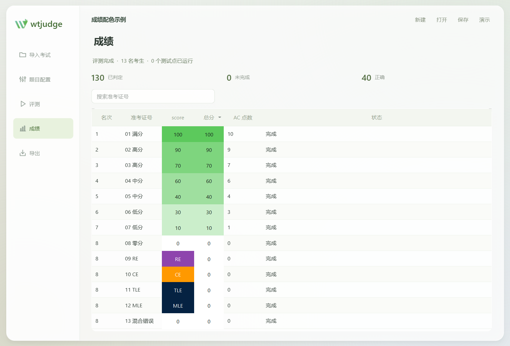
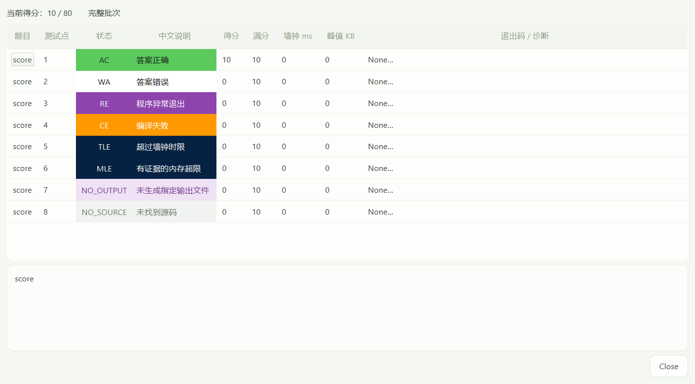

# wtjudge v1.1.1

面向 Windows 10/11 x64 的本地 C++14 考试评测工具。导入考生源码和测试数据，批量编译、评测、查看成绩，导出 Excel、CSV 和 HTML 报告。评测过程无需服务器或联网。

v1.1.1 保留简约磨砂界面，并统一成绩底色和错误状态配色。支持动态识别考生、题目及测试点，逐点诊断、手动指定源码、保存考试配置和完整性检查。

## 选择安装方式

| 方式 | 适合人群 | 是否需要 Python | 是否需要 MinGW-w64 G++ |
|---|---|---|---|
| **下载 Release 程序包（推荐）** | 直接使用软件的教师 | 不需要 | 需要 |
| 下载源码并运行 | 修改代码、调试或自行构建 | 需要，建议 3.12 x64，最低 3.11 | 需要 |

支持 Windows 10/11 **64 位 x86_64**。当前发布包不包含编译器，也不支持 macOS、Linux、32 位 Windows 或原生 ARM64。Python 和编译器初次安装需要网络，准备好后可以离线评测。

## 一、下载安装程序

1. 打开本仓库的 **[Releases 下载页](https://github.com/loingrin/wtjudge/releases/tag/v1.1.1)**。
2. 下载 **[wtjudge-v1.1.1-windows-x64.zip](https://github.com/loingrin/wtjudge/releases/download/v1.1.1/wtjudge-v1.1.1-windows-x64.zip)**。GitHub 自动提供的 `Source code (zip)` / `Source code (tar.gz)` 是源码，不是可直接运行的程序。
3. 右键 ZIP →“全部解压缩”，解压到自己可写的普通文件夹；不要直接在压缩包内运行。
4. 双击 `wtjudge.exe`。请保留整个目录，尤其是 `_internal/`；只复制 EXE 将无法启动。
5. 按下一节准备编译器，在软件“题目配置”中选择 `g++.exe` 并点击“验证编译器”。

**使用 Release 程序包时，无需安装 Python、pip 或运行 `setup.bat`。** 程序尚未进行代码签名，Windows 可能显示未知发布者；请核对下载来源和发布页提供的校验值。

## 二、检查或安装 MinGW-w64

### 已经安装过 Dev-C++、MinGW-w64 或 MSYS2

在 Windows **PowerShell** 中执行：

```powershell
Get-Command g++ -ErrorAction SilentlyContinue
where.exe g++
g++ --version
g++ -dumpmachine
```

`-dumpmachine` 应显示 x86_64 Windows 目标，例如 `x86_64-w64-mingw32`。如果提示找不到命令，只能说明 PATH 中没有它，电脑上仍可能已经安装。可检查已有工具链的 `bin` 文件夹；也可使用完整路径检查：

```powershell
& 'C:\msys64\ucrt64\bin\g++.exe' --version
& 'C:\msys64\ucrt64\bin\g++.exe' -dumpmachine
```

在软件中选择**真实存在的完整 `g++.exe` 路径**，点击“验证编译器”。软件会验证版本，并实际进行 GNU++14 试编和试运行。通过此检查才算配置成功。无需为了 wtjudge 修改全局 PATH，也不要只拷贝一个 `g++.exe`：编译器、链接器和同一工具链的 DLL 必须保持完整。

### 没有编译器：使用 MSYS2 UCRT64

1. 从 [MSYS2 官网](https://www.msys2.org/) 下载并安装 x86_64 版本，通常安装到 `C:\msys64`。当前 MSYS2 安装器要求 Windows 10 1809 或更新版本。
2. 从开始菜单打开 **MSYS2 UCRT64** 终端。在这个终端执行以下命令，**不要在 PowerShell 中执行 `pacman`**：

   ```bash
   pacman -Suy
   ```

   如升级提示关闭终端，按提示完成后重新打开 UCRT64，再执行一次，直到更新完成。
3. 仍在 **MSYS2 UCRT64** 中安装 G++：

   ```bash
   pacman -S mingw-w64-ucrt-x86_64-gcc
   g++ --version
   g++ -dumpmachine
   ```

4. 回到 wtjudge，选择 `C:\msys64\ucrt64\bin\g++.exe`，点击“验证编译器”。如果安装位置不同，使用对应路径。不要选 `C:\msys64\usr\bin` 中的 MSYS 编译器。

安装命令和环境选择依据 [MSYS2 安装说明](https://www.msys2.org/)、[更新说明](https://www.msys2.org/docs/updating/)及 [UCRT64 环境说明](https://www.msys2.org/docs/environments/)。已有完整的 MinGW-w64 G++ 且验证通过时，可继续使用，无需重复安装。

## 三、从源码运行（可选）

已下载 Release 程序包的用户可跳过本节。

1. 从 [Python 官方 Windows 下载页](https://www.python.org/downloads/windows/) 安装 **Python 3.12 x64**（已验证系列；最低要求 3.11）。选择正常的 64 位安装方式，不要选择 32 位或 embeddable package；安装 pip 和 Python Launcher，传统安装器可勾选 `Add python.exe to PATH`。

   若官网下载的是 **Python Install Manager**，安装管理器后，在 PowerShell 中执行下列命令安装 3.12，再进行下一步。传统 Python 安装器用户不需要执行它。详见 [Python 官方 Windows 说明](https://docs.python.org/3/using/windows.html)。

   ```powershell
   py install 3.12
   ```

2. 下载 **[v1.1.1 源码包](https://github.com/loingrin/wtjudge/releases/download/v1.1.1/wtjudge-v1.1.1-source.zip)** 并完整解压。在源码根目录打开新的 PowerShell，检查版本与位数：

   ```powershell
   py -3.12 --version
   py -3.12 -c "import struct; print(struct.calcsize('P') * 8)"
   ```

   第二条应输出 `64`。若只安装了其他兼容版本，可用对应的 `py -3.11` 等命令；只有 `python` 命令可用时，先用 `python --version` 和相同的 `-c` 命令确认解释器。更高的 Python 版本需确认当前依赖提供对应安装包。
3. 建议先固定虚拟环境使用的解释器，再运行安装脚本：

   ```powershell
   py -3.12 -m venv .venv
   .\setup.bat
   ```

   `setup.bat` 会在本目录创建或使用 `.venv`，检查 Python 版本和位数，并安装 `requirements.txt`。首次安装依赖需要联网。若没有预建 `.venv`，脚本优先使用 `py -3`，再尝试 `python`。
4. 安装成功后双击 **`run.bat`**，或在 PowerShell 执行 `.\run.bat`。再按第二节配置 MinGW-w64。

也可以完全手动安装和启动，不需要激活虚拟环境：

```powershell
py -3.12 -m venv .venv
.\.venv\Scripts\python.exe -m pip install --upgrade pip
.\.venv\Scripts\python.exe -m pip install -r requirements.txt
.\.venv\Scripts\python.exe app.py
```

更详细的环境排查、离线依赖、测试和打包方法见 [安装与维护说明](docs/INSTALL.md)。

## 四、准备考试资料

建议把考试放在软件目录以外，便于备份和升级。示例：

```text
exam/
├─ submissions/                 # 在软件中选择这个考生目录
│  ├─ 001/
│  │  ├─ add/
│  │  │  └─ add.cpp
│  │  └─ distance/
│  │     └─ distance.cpp
│  └─ 002/
│     ├─ add/
│     │  └─ add.cpp
│     └─ distance/
│        └─ distance.cpp
├─ testdata/                    # 在软件中选择这个测试数据目录
│  ├─ add/
│  │  ├─ 1.in
│  │  ├─ 1.out
│  │  ├─ 2.in
│  │  └─ 2.out
│  └─ distance/
│     ├─ 1.in
│     └─ 1.out
└─ score/                       # 报告输出目录
```

考生文件夹名称作为考生 ID，保留前导零；每个测试点的 `.in` 和 `.out` 必须同名成对。另支持 `submissions/001/add.cpp` 这样的平铺提交。每个考生每题使用一个 `.cpp` 入口，不合并多个源文件；题目与测试点数量无需固定。题目目录只扫描直接文件，不递归扫描更深层子目录。

学生程序需要采用**文件输入输出**，例如 `freopen("add.in", "r", stdin)`、`freopen("add.out", "w", stdout)`。软件在每个测试点的独立目录中运行程序，只比较配置指定的输出文件；只向控制台打印答案会得到 `NO_OUTPUT`。

## 五、使用步骤

1. **导入考试**：填写考试名称，选择考生目录、测试数据目录和报告输出目录，等待检查完成；需要时点击“检查资料”。
2. **核对资料**：查看考生、题目和测试点数量及“检查详情”。修复缺少配对测试数据或重名冲突。源码找不到或存在歧义时，点击“指定源码…”或双击对应题目格，明确选定该考生的源码；不要让同一道题误用其他题的文件。
3. **配置编译器**：进入“题目配置”，选择 G++ 的完整路径并点击“验证编译器”。
4. **配置题目**：双击题目或点击“编辑题目…”，核对输入、输出文件名、时间、内存、满分、比较方式和测试点分值。平均分默认分配整数余数，自定义分值之和必须等于满分。
5. **开始评测**：到“评测”页点击“开始评测”，阅读首次权限提示并确认。后台依次处理提交，可切换页面查看进度。评测时保持源码和标准数据不变。
6. **查看成绩**：到“成绩”页搜索考生、点击表头排序，双击题目成绩查看逐点状态、耗时、内存和编译/运行诊断。确认批次显示完整后再使用正式排名。
7. **导出报告**：批次结束默认自动导出，也可到“导出”页点击“导出报告”，生成 Excel、CSV、HTML 和 `results.json`。每次创建新的时间戳子目录，不覆盖旧报告；HTML 可直接在浏览器中打开。
8. **保存考试**：顶部“保存”会保存目录引用、题目设置、分值与源码映射。项目文件保存配置，不包含成绩；请另外备份考试目录和导出报告。再次“打开”项目后核对检查结果并重新验证编译器。

初次使用可点击顶部“演示”，验证编译器后评测内置示例，再导入自己的考试。新建或切换考试不删除原资料；变更配置后旧成绩会清空，需要重新评测。

## 六、成绩与状态

成绩单以相对于满分的比例着色：**0 分白底、1—30% 浅绿、31—60% 中绿、61—99% 深绿、满分最深绿**；总分按所有题目总满分计算。自定义满分也使用相同比例。



| 状态 | 含义 | 颜色 |
|---|---|---|
| AC | 答案正确，获得该点分数 | 绿色 |
| WA | 答案错误 | 白色 |
| RE | 运行错误或异常退出 | 紫色 |
| CE | 编译错误 | 橙黄色 |
| TLE / MLE | 超时 / 超内存 | 近黑藏蓝色 |
| NO_SOURCE / NO_OUTPUT | 缺少源码 / 没有生成指定输出文件 | 灰色 / 浅紫色 |
| OUTPUT_LIMIT | 输出超过大小限制 | 近黑藏蓝色 |

整题测试点完整且全部为同一种 RE、CE、TLE、MLE 等错误时，题目成绩格直接显示错误代号；混合状态继续显示数字。全部 WA 仍显示数字 0。Excel、HTML 同步配色；CSV/JSON 保留原始数值，错误代号不会改变得分。



**停止评测、`CANCELLED`、`SYSTEM_ERROR` 或未解决的源码歧义会导致结果不完整，不提供正式排名。** 停止会终止当前进程树并保留已完成点；排查后需要重新评测整批，不支持断点续评。缺源码和编译错误是已判定的 0 分状态，与未执行或系统错误不同。

## 七、常见问题与使用范围

- **下载后找不到 `wtjudge.exe`**：确认下载的是 Releases 中的程序附件，而不是 GitHub 的源码 ZIP。
- **Python、pip 或依赖报错**：见 [Python 与依赖排查](docs/INSTALL.md#python-与依赖排查)，使用 `.venv` 内的 Python 安装依赖，避免装到另一个解释器中。
- **编译器能显示版本，但验证失败**：检查是否保留了完整工具链和 DLL，并查看试编/试运行诊断；见 [编译器排查](docs/INSTALL.md#编译器排查)。
- **程序明明输出答案却显示 `NO_OUTPUT`**：检查 `freopen` 名称与软件配置一致，扩展名没有写错，程序实际创建了指定输出文件。
- **为什么与其他平台耗时或内存不同**：本软件使用 Windows 墙钟时间和 Job 提交内存，包含进程启动开销；与 Linux 时间、RSS 指标不同。正式使用前请在本机校准限制，并记录编译器版本。

目前支持单源 C++14、文件 I/O 和整数测试点计分；不支持 SPJ、交互题、分组依赖、在线提交或多语言。默认比较忽略换行形式、行末空白和末尾空行，也可选择严格比较或单词比较。

**学生程序以当前 Windows 用户权限运行。Job Object 提供资源和进程控制，不是安全沙箱。请只评测可信提交；有风险时使用独立虚拟机或 Windows Sandbox。** 软件不要求管理员权限，不自动上传源码或报告。

更新内容见 [CHANGELOG](CHANGELOG.md)。开发者可按 [安装与维护说明](docs/INSTALL.md#测试与打包)运行测试、构建自己的程序包。

第三方依赖的版权、许可证及对应源码入口见 [第三方软件说明](docs/THIRD_PARTY_NOTICES.md)，许可证原文随下载包附在 `third_party/` 中。

界面操作参考了 [LemonLime 项目](https://github.com/Project-LemonLime/Project_LemonLime) 的本地评测工作流；本项目使用 Python/PySide6 实现。
